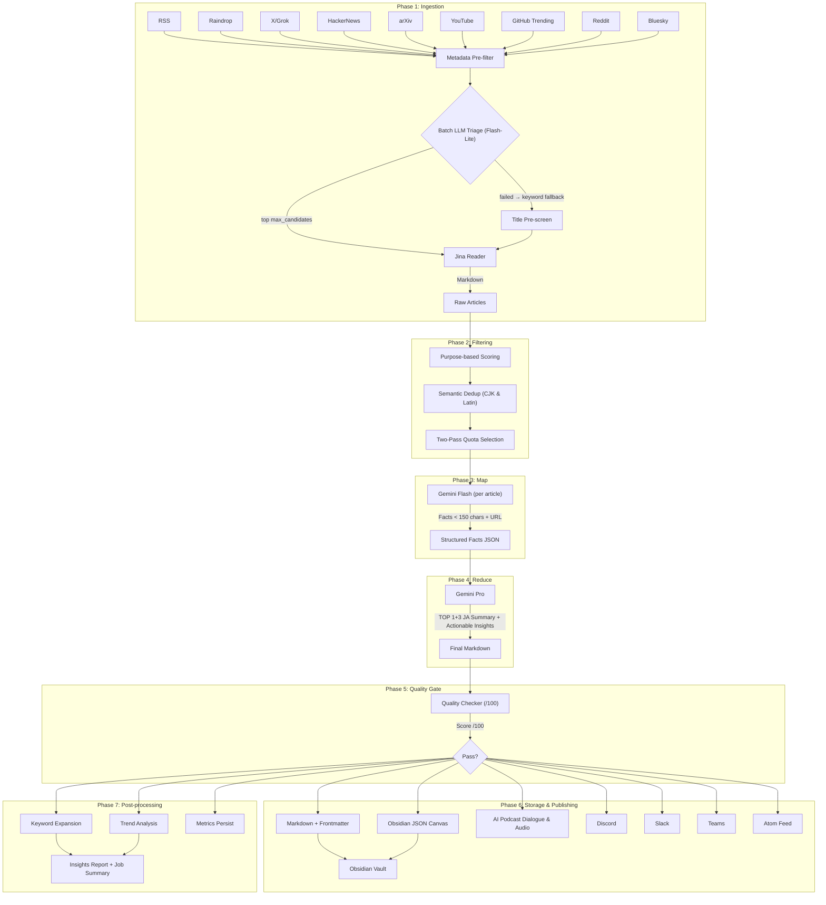
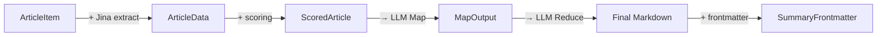

# Architecture

## Pipeline Overview

Digital Trend Flow は 7 フェーズの Map-Reduce パイプラインで構成されています。



週次・月次・年次のレポートは別のワークフローで生成し、Zenn・note.com・通知に配信します（[Periodic Reports](#periodic-reports)）。

---

## Core Data Models

パイプラインは **5 つの中間データモデル** でフェーズ間を接続しています。各モデルは TypeScript の `interface` として型定義され、フェーズ間の契約 (Contract) を明示します。

### データモデル一覧



---

### 1. `ArticleItem` — Ingestion 出力

ソースアダプター（RSS, Raindrop, Grok 等）が共通で返す **正規化済み記事メタデータ**。全 7 ソースがこの型に変換して返す。

```typescript
// src/core/types.ts
interface ArticleItem {
  sourceName: string;   // 情報源の表示名
  sourceType: string;   // "rss" | "raindrop" | "xai_grok" | ...
  purpose: string;      // config.purposes のキー
  title: string;        // 記事タイトル（公開時のまま。ソース固有の装飾は付けない）
  url: string;          // 正規化済み URL
  publishedAt: string;  // ISO 8601
  language?: string;    // "ja" | "en" (多言語対応)
  description?: string; // ソースの要約（本文の抽出に失敗したときに使う）
  author?: string;      // 著者・チャンネル（YouTube など）
  engagement?: { score?: number; likes?: number; starsToday?: number }; // HN の points、Reddit の upvote、Bluesky の like、GitHub の当日の star
}
```

エンゲージメントはタイトルに埋め込まず、`describeEngagement`（`src/core/article.ts`）で 1 行にしてトリアージと Map のプロンプトに別項目として渡す。重複排除・キーワード判定・要約の見出しは、装飾のないタイトルで行われる。

**境界の意図**: ソースごとに異なる生データ形式（RSS XML, Raindrop JSON, HN API 等）をすべて `ArticleItem` に正規化することで、下流のフィルタリングは**ソースの種類を一切知らない**。新規ソース追加時も、この型に変換すれば既存パイプラインがそのまま動作する。

### 2. `ArticleData` — Filtering 入力

Jina Reader で本文 Markdown を抽出した後の **コンテンツ付き記事データ**。

```typescript
// src/filtering/scorer.ts
interface ArticleData {
  url: string;          // 正規化済み URL
  title: string;
  content: string;      // Jina Reader が返した Markdown 本文
  publishedAt?: string; // 鮮度スコアリング用
  language?: string;
}
```

**`ArticleItem` → `ArticleData` の変換**: `main.ts` の Phase 2 で Jina Reader の結果を合成する。`content` フィールドが追加される点が `ArticleItem` との唯一の差分。

### 3. `PurposeScoreOutput` — Scoring 出力

スコアリングエンジンが返す **評価結果**。除外判定・スコア・マッチしたキーワード・割り当てカテゴリを含む。

```typescript
// src/filtering/scorer.ts
interface PurposeScoreOutput {
  isExcluded: boolean;
  exclusionReason?: string;
  assignedPurpose: string;    // config.purposes のキー
  purposeLabel: string;       // "🔬 AI・LLM 研究" 等
  totalScore: number;
  matchedKeywords: string[];
  freshnessFactor?: number;   // 鮮度係数 (0.3–1.0)
}
```

**内部中間型 `ScoredArticle`**: `main.ts` でのみ使用されるパイプライン内部型。`ArticleData` + `PurposeScoreOutput` を合成する。

```typescript
// src/main.ts (パイプライン内部型)
interface ScoredArticle {
  article: ArticleData;
  score: number;
  purpose: string;
  purposeLabel: string;
  matchedKeywords: string[];
}
```

### 4. `MapInput` / `MapOutput` — LLM Map フェーズ

Map フェーズの入出力。1 記事 → 1-5 個の構造化ファクトに圧縮する。

```typescript
// src/summarization/gemini_map.ts
interface MapInput {
  title: string;
  url: string;
  content: string;      // Markdown 本文 (最大 10,000 字に truncate)
  language?: string;
}

interface ExtractedFact {
  text: string;         // 150 字以内の簡潔なファクト
  importance: number;   // 1-10 の重要度
}

interface MapOutput {
  source_title: string; // 出典タイトル (Citation 用)
  source_url: string;   // 出典 URL (Citation 用)
  facts: ExtractedFact[];
}
```

**Reduce 入力時の拡張**: `main.ts` で `MapOutput` に `purpose` / `purposeLabel` / `score` をマージして Reduce に渡す。

```typescript
// Reduce への入力 (main.ts で合成)
type ReduceInput = MapOutput & {
  purpose: string;
  purposeLabel: string;
  score: number;
};
```

### 5. `SummaryFrontmatter` — Storage 出力

Obsidian Vault に保存する Markdown の YAML Frontmatter 構造。DataView クエリ最適化済み。

```typescript
// src/storage/markdown_builder.ts
interface SummaryFrontmatter {
  tags?: string[];
  categories?: string[];
  sources?: string[];
  topStory?: string;
  previousDate?: string;
  // DataView 拡張フィールド
  articleCount?: number;
  topPurpose?: string;
  mentionedCompanies?: string[];
  mentionedTechnologies?: string[];
  estimatedCostUsd?: number;
  executionTimeSec?: number;
  qualityScore?: number;
  relatedNotes?: string[];
}
```

---

## Data Flow — フェーズ間のスキーマ変換

以下は 1 記事がパイプラインを通過する際の、各フェーズでのデータ形態の変化を示します。

```txt
Phase 1: Ingestion
  外部 API 応答 (RSS XML, JSON, HTML)
       ↓ ソースアダプター (7種)
  ArticleItem { sourceName, sourceType, purpose, title, url, publishedAt }
       ↓ State Manager: isProcessed(url) で重複排除
       ↓ excludeByMetadata(): ドメイン・NGワードチェック
       ↓ triageArticles(): タイトル・説明文・情報源をまとめて LLM で判定
       ↓   (関連度・目的・重要度・重複先。上位 max_candidates 件だけ残す。
       ↓    失敗時は titlePassesPreScreen() のキーワード事前選別に戻る)
       ↓ Jina Reader: extractMarkdown(url) → Markdown 本文
Phase 2: Filtering
  ArticleData { url, title, content, publishedAt }
       ↓ calculatePurposeScore(): 除外ルール + キーワードマッチ + 鮮度 + TF-IDF
       ↓   (トリアージ経由の記事は閾値で落とさず、スコアは重要度ベース)
       ↓ semanticDedup(): タイトル類似度で重複排除
       ↓ twoPassSelect(): Min/Max クォータで選定
  ScoredArticle { article, score, purpose, purposeLabel, matchedKeywords }

Phase 3: Map (per article)
  MapInput { title, url, content (≤10,000字) }
       ↓ LLM Gateway → Gemini Flash
  MapOutput { source_title, source_url, facts[{text, importance}] }

Phase 4: Reduce (batch)
  ReduceInput[] = MapOutput + { purpose, purposeLabel, score }
       ↓ LLM Gateway → Gemini Pro
  Final Markdown (日本語 TOP 1+3 サマリー)

Phase 5: Quality Gate
  summaryMarkdown + expectedSourceUrls
       ↓ evaluateQuality()
  QualityCheckResult { overallScore, checks[], passCount, failCount }

Phase 6: Storage & Publishing
  Markdown + SummaryFrontmatter → Obsidian Vault
  Markdown → Discord / Slack / Teams / note.com / Atom Feed

Phase 7: Post-processing
  markAsProcessed() → SQLite
  metrics.persist() → JSON
  savePipelineRun() → SQLite
```

---

## Configuration Schema (Zod)

`config.yml` と環境変数はすべて **Zod 4 スキーマ** でバリデーションされます。不正な設定はパイプライン起動前に拒否されます。

### ConfigSchema 構造

```typescript
// src/core/types.ts
ConfigSchema = z.object({
  version: z.string(),                    // "2.0"
  settings: z.object({
    daily_threshold_score: z.number(),
    models: ModelProviderSchema,          // { platform, map, reduce, thinking }
    fallback_models: FallbackModelSchema, // optional
    author: z.string(),
    freshness: { enabled, decay_lambda, max_age_hours },
    state_ttl_days: z.number(),
    triage: { enabled, model?, max_candidates, batch_size, min_relevance },
    semantic_dedup: { enabled, similarity_threshold },
  }),
  purposes: z.record(string, PurposeSchema),  // 動的キー
  exclude: ExcludeSchema,
});
```

### SourceSchema — Discriminated Union

ソースの型安全性は `z.discriminatedUnion("type", [...])` で保証されます。`type` フィールドの値に応じて、必須・任意フィールドが自動的に切り替わります。

```typescript
SourceSchema = z.discriminatedUnion("type", [
  z.object({ type: z.literal("rss"),            name, url, language? }),
  z.object({ type: z.literal("xai_grok"),       name, query, language? }),
  z.object({ type: z.literal("raindrop"),       name, collection_id, archive_collection_id?, lookback_hours }),
  z.object({ type: z.literal("hackernews"),     name, min_score, max_items }),
  z.object({ type: z.literal("arxiv"),          name, query, max_results }),
  z.object({ type: z.literal("youtube"),        name, channel_id?, query?, max_results }),
  z.object({ type: z.literal("github_trending"), name, language_filter?, since }),
]);
```

### EnvSchema — Secret バリデーション

```typescript
EnvSchema = z.object({
  GEMINI_API_KEY: z.string().min(1),         // Required
  RAINDROP_TEST_TOKEN: z.string().optional(), // Optional sources
  XAI_API_KEY: z.string().optional(),
  YOUTUBE_API_KEY: z.string().optional(),
  OPENAI_API_KEY: z.string().optional(),      // Fallback LLM
  ANTHROPIC_API_KEY: z.string().optional(),
  // ... publishing, observability keys
});
```

---

## Persistence Schema (SQLite)

`pipeline_state.db` は WAL モードで動作し、4 テーブルでパイプラインの状態を管理します。スキーマの版は `PRAGMA user_version` に記録し、開くときに `state_manager.ts` の `MIGRATIONS` を順に適用します (現在 version 3)。DB のパスは環境変数 `PIPELINE_STATE_DB` で差し替えられます (テストでは `:memory:`)。

### processed_urls — 冪等性保証

| Column         | Type    | Description                |
| :------------- | :------ | :------------------------- |
| `url`          | TEXT PK | 正規化済み記事 URL         |
| `title`        | TEXT    | 記事タイトル               |
| `score`        | REAL    | パイプラインスコア         |
| `purpose`      | TEXT    | 割り当てカテゴリ           |
| `processed_at` | TEXT    | 処理日時                   |
| `expires_at`   | TEXT    | TTL 期限 (default: +90 日) |

### evaluated_urls — 評価済み (不採用) の記事

本文を取得して評価したが要約に使わなかった記事を短期間記録し、次の実行では本文の取得前に除きます (件数は metrics の `articles_skipped_evaluated`)。規則で決まる結果だけを記録し、本文の抽出に失敗した記事 (説明文で採点したもの) や、選ばれたのに Map が失敗した記事は記録しません。

| Column         | Type    | Description                                                                 |
| :------------- | :------ | :-------------------------------------------------------------------------- |
| `url`          | TEXT PK | 正規化済み記事 URL                                                          |
| `outcome`      | TEXT    | `below_threshold` (閾値未満) / `excluded` (除外ルール) / `not_selected` (選外) |
| `score`        | REAL    | パイプラインスコア                                                          |
| `purpose`      | TEXT    | 割り当てカテゴリ                                                            |
| `evaluated_at` | TEXT    | 評価日時                                                                    |
| `expires_at`   | TEXT    | 有効期限 (`settings.evaluated_ttl_days`、既定 7 日)                          |

`not_selected` は公開まで進んだ実行でだけ記録します (degraded の実行では記録しない)。

### pipeline_runs — 実行履歴

| Column                | Type    | Description           |
| :-------------------- | :------ | :-------------------- |
| `run_id`              | TEXT PK | UUID                  |
| `date`                | TEXT    | 実行日                |
| `articles_ingested`   | INTEGER | 取得記事数            |
| `articles_scored`     | INTEGER | スコアリング通過数    |
| `articles_selected`   | INTEGER | 最終選定数            |
| `articles_by_purpose` | TEXT    | カテゴリ別分布 (JSON) |
| `total_input_tokens`  | INTEGER | 入力トークン合計      |
| `total_output_tokens` | INTEGER | 出力トークン合計      |
| `total_cost_usd`      | REAL    | 推定コスト合計        |
| `quality_score`       | REAL    | 品質スコア            |
| `metrics_json`        | TEXT    | 完全メトリクス (JSON) |
| `run_status`          | TEXT    | `success` / `degraded` / `skipped` / `failed` |
| `status_reasons`      | TEXT    | ステータスの理由 (JSON 配列) |

### source_health — ソース健全性

| Column          | Type    | Description              |
| :-------------- | :------ | :----------------------- |
| `source_name`   | TEXT    | ソース名                 |
| `source_type`   | TEXT    | ソース種別               |
| `check_date`    | TEXT    | チェック日               |
| `status`        | TEXT    | `ok` / `empty` / `error` |
| `article_count` | INTEGER | 取得記事数               |
| `error_message` | TEXT    | エラー詳細               |

PK: `(source_name, check_date)`

---

## Boundary Design — 変化に強い構造

### 設計原則

このシステムは「**情報源は頻繁に増減する**」「**LLM プロバイダーは変わりうる**」「**出力先は要件で追加される**」という前提で設計されています。以下の 4 つの境界で変化を局所化します。

### Boundary 1: Source Adapter 境界

```txt
外部 API (RSS XML, JSON, HTML, ...)
    ↓ ソースアダプター (src/ingestion/*.ts)
ArticleItem (正規化済み共通型)
    ↓ パイプライン本体 (src/main.ts)
```

**何を隔離しているか**: 外部 API の形式・認証方式・ページネーション・エラー処理をアダプター内に閉じ込めています。`main.ts` は `ArticleItem[]` しか受け取りません。

**変化への耐性**:

- **新規ソース追加**: `src/ingestion/` にアダプターを 1 ファイル追加し、`SourceSchema` に discriminated union のバリアントを追加するだけ。既存コードの変更は `main.ts` のルーティング部分のみ。
- **既存ソースの API 変更**: 該当アダプター内のみ修正。`ArticleItem` の契約が守られる限り下流への影響はゼロ。
- **ソースの無効化**: API キー未設定で自動スキップ。設定ファイルからソースを削除するだけ。

### Boundary 2: LLM Gateway 境界

```txt
パイプライン (Triage/Map/Reduce)
    ↓ LLMRequest (統一リクエスト型)
llm_gateway.ts
    ↓ プロバイダー固有 API (Gemini, OpenAI, Anthropic)
LLMResponse (統一レスポンス型)
    ↓ パイプラインに復帰
```

**何を隔離しているか**: LLM プロバイダーの API 仕様差（認証ヘッダー、リクエスト形式、Structured Output の指定方法、トークンカウントの取得方法）をゲートウェイ内に閉じ込めています。

```typescript
// 呼び出し側は provider を意識しない
interface LLMRequest {
  systemPrompt: string;
  userPrompt: string;
  phase: "map" | "reduce" | "triage" | ...;
  model?: string;                            // 主プロバイダーのモデルを上書き
  responseSchema?: Record<string, unknown>;  // Structured Output
  temperature?: number;
  maxOutputTokens?: number;
}

interface LLMResponse {
  text: string;
  model: string;
  provider: string;
  inputTokens: number;
  outputTokens: number;
  latencyMs: number;
}
```

**変化への耐性**:

- **プロバイダー追加**: `callProvider()` 内に `case` を追加するだけ。
- **プロバイダー障害**: Circuit Breaker が自動フォールバック（連続 3 回失敗 → 5 分 OPEN → 次プロバイダーへ）。
- **モデル更新**: `config.yml` の `latest-flash` / `latest-pro` で自動解決。コード変更不要。
- **Structured Output 対応差**: `responseSchema` の有無でプロバイダーごとに適切な形式に変換。

### Boundary 3: Scoring / Filtering 境界

```txt
config.yml (purposes, scoring, exclude)
    ↓ Zod パース → 型安全な AppConfig
ArticleData
    ↓ scorer.ts (純粋関数: LLM 呼び出しなし)
PurposeScoreOutput
```

LLM による関連性判定は `llm_triage.ts`（本文取得前のバッチトリアージ）に分離しています。

**何を隔離しているか**: スコアリングのロジック（キーワードマッチ、TF-IDF、鮮度計算、除外ルール）と、ビジネスルール（どのカテゴリに何点以上で採用するか）を分離しています。

**変化への耐性**:

- **カテゴリの追加・変更**: `config.yml` の `purposes` セクションを編集するだけ。コード変更不要。
- **キーワードの追加・重み調整**: `config.yml` の `keywords` を変更するだけ。
- **除外ルールの強化**: `exclude` セクションにドメイン・キーワードを追加。正規表現もサポート。
- **スコアリングアルゴリズム変更**: `scorer.ts` 内で完結。入出力型が同じなら他モジュールに影響しない。

### Boundary 4: Publishing 境界

```txt
Final Markdown + SummaryFrontmatter
    ↓ Publishing Adapter (src/publishing/*.ts)
外部プラットフォーム (Discord, Slack, Teams, Email, Zenn, note.com, Atom)
```

**何を隔離しているか**: 各配信先のウェブフック形式・API 仕様・文字数制限・フォーマット変換を個別アダプター内に閉じ込めています。

**変化への耐性**:

- **配信先の追加**: `src/publishing/` にアダプターを追加し、`src/core/builtin_plugins.ts` で `PublishingPlugin` として登録する。日次・週次・月次・年次の各実行は `registry.publishAll()` で登録済みの配信先をすべて呼ぶので、`main.ts` や CLI の変更は不要。
- **配信先の無効化**: 環境変数 (Webhook URL 等) 未設定で自動スキップ（`isConfigured()`）。レポートの種類ごとの配信先は `config.yml` の `settings.publishing` で決める。
- **障害の隔離**: 配信先ごとに `Promise.allSettled` で実行し、1 つの失敗が他の配信を止めない。

### 境界の全体像

```txt
┌──────────────────────────────────────────────────────┐
│  config.yml + .env                                   │
│  ┌─────────────────────────────────────────────────┐ │
│  │  Zod Schema Validation (types.ts)               │ │
│  │  → AppConfig / EnvConfig (型安全な設定)          │ │
│  └─────────────────────────────────────────────────┘ │
│                                                      │
│  ┌─── Boundary 1 ───┐  ┌─── Boundary 3 ──────────┐ │
│  │ Source Adapters   │  │ Scorer (pure functions)  │ │
│  │ (9 types)         │  │ config-driven rules     │ │
│  │   ↓ ArticleItem   │  │   ↓ PurposeScoreOutput  │ │
│  └───────────────────┘  └─────────────────────────┘ │
│                                                      │
│  ┌─── Boundary 2 ───────────────────────────────────┐│
│  │ LLM Gateway (llm_gateway.ts)                     ││
│  │  LLMRequest → [Gemini|OpenAI|Anthropic] →        ││
│  │  LLMResponse + Circuit Breaker                   ││
│  └──────────────────────────────────────────────────┘│
│                                                      │
│  ┌─── Boundary 4 ───┐  ┌── Persistence ──────────┐ │
│  │ Publishing        │  │ SQLite (WAL mode)       │ │
│  │ (6 publishers)    │  │ processed_urls          │ │
│  │   ↑ Markdown      │  │ pipeline_runs           │ │
│  └───────────────────┘  │ source_health           │ │
│                          └────────────────────────┘ │
└──────────────────────────────────────────────────────┘
```

---

## Map-Reduce 戦略

大量の記事を直接高性能モデルに渡すと **API コストが爆発** し、Long Context での品質低下も発生します。

| Phase      | Model        | Role                                              | Input Limit     |
| :--------- | :----------- | :------------------------------------------------ | :-------------- |
| **Map**    | Gemini Flash | 各記事 → Facts (< 150 字) + 出典 URL を JSON 抽出 | ~10,000 字/記事 |
| **Reduce** | Gemini Pro   | 全 Facts → 日本語 "TOP 1+3" サマリーに統合        | 全 Facts JSON   |

**効果**: コスト 1/10 以下、出力品質の安定化、出典 URL の完全追跡。

**Reduce の入力制限**: `MAX_REDUCE_INPUT_CHARS = 200,000` を超える場合、`importance < 5` のファクトを自動プルーニング。

## Multi-LLM Gateway

`src/summarization/llm_gateway.ts` が Google Gemini / OpenAI / Anthropic を統一インターフェースで抽象化します。

### Circuit Breaker Pattern

```txt
候補 A (google/map-model) → 失敗 3 回 → Circuit OPEN → 次の候補にフォールバック
                                  ↓ (5 分 cooldown)
                             Circuit CLOSED → 候補 A に復帰
```

- **単位**: サーキットは候補（`platform/model`）ごと。過負荷の 1 モデルが、同じプラットフォームの健全なモデルまで止めない
- **閾値**: 連続 3 回失敗で回路 OPEN（5xx・タイムアウト・ネットワーク障害のみを数える）
- **Cooldown**: 5 分で自動復帰
- **クライアントエラー** (400/401/403 など): 再試行せずにエラーを記録し、次の候補（同一プラットフォーム上のもう一方のフェーズのモデル → `fallback_models`）へフォールバックする。モデル固有の失敗で同じプラットフォームの健全なモデルまで遮断しないよう、サーキットブレーカーには数えない

### Structured Output

`responseSchema`（`prompts.ts` の Gemini 形式の OpenAPI サブセット。型は `OBJECT` などの大文字）は、プロバイダーごとに次の形で送ります。

- **Gemini**: `responseMimeType: application/json` と `responseSchema` をそのまま
- **OpenAI**: JSON Schema（型を小文字にし、各オブジェクトに `additionalProperties: false`）を `response_format.json_schema` で。全プロパティが必須のスキーマだけ `strict: true`
- **Anthropic**: 同じ JSON Schema を `input_schema` にしたツールを 1 つ定義し、`tool_choice` でその呼び出しを強制する。ツール呼び出しの `input` を JSON 文字列にして返す

### Auto Model Resolution

`config.yml` で `latest-flash` / `latest-pro` を指定すると、Gemini API の `models` エンドポイントから最新の安定モデルを自動解決します。実験的モデル (`-exp`) に加え、`generateContent` 非対応のモデルと、音声合成 (`-tts`)・画像生成 (`-image`)・ネイティブ音声 (`-audio`)・Live API (`-live`)・埋め込み (`embedding`) などの派生モデルも除外します。

## Plugin Architecture

`src/core/plugin_registry.ts` がソースと配信先を解決します。組み込みのソース 9 種と配信先 6 種（Discord・Slack・Teams・Email・Zenn・note.com）は `src/core/builtin_plugins.ts` で登録され、パイプライン（`main.ts`）と定期レポートの CLI（`src/cli/report.ts`）はレジストリだけを呼びます。新しいソース・配信先は、プラグインを登録するだけで追加できます（ソースの場合は `config.yml` のスキーマ `SourceSchema` にも型を追加する）。

### Plugin Interfaces

```typescript
interface IngestionPlugin<S extends Source = Source> {
  readonly name: string;
  readonly type: S["type"];                       // config.yml の source.type
  fetch(source: S, purpose: string): Promise<ArticleItem[]>; // 失敗時は throw
  onPublished?(publishedUrls: string[]): Promise<void>;     // 配信後の処理（Raindrop のアーカイブ）
}

interface PublishingPlugin {
  readonly name: string;
  readonly kinds?: readonly ReportKind[];         // "daily" | "weekly" | "monthly" | "yearly"
  isConfigured?(): boolean;                       // false ならスキップ
  publish(payload: PublishPayload): Promise<void>; // 失敗時は throw（他の配信先には影響しない）
}
```

### Event Bus

パイプラインの各フェーズで以下のイベントが発火されます。組み込みのハンドラが、各イベントを実行の Langfuse トレースにイベントとして記録します（Langfuse 未設定時は何もしない）:

| Event                | Timing                   |
| :------------------- | :----------------------- |
| `ingestion:start`    | パイプライン開始時       |
| `ingestion:complete` | 全ソース取得完了         |
| `scoring:complete`   | フィルタリング・選定完了 |
| `map:complete`       | Map フェーズ完了         |
| `reduce:complete`    | Reduce フェーズ完了      |
| `quality:complete`   | 品質評価完了             |
| `publish:complete`   | 全チャンネル配信完了     |
| `pipeline:complete`  | パイプライン正常終了     |
| `pipeline:error`     | 致命的エラー発生、または degraded 判定 |

## Quality Gate

公開の可否は `src/evaluation/run_gate.ts` が判定します。次のいずれかに該当する実行は **degraded（劣化）** となります。

| 条件 | 既定値（`config.yml` の `settings.quality_gate`） |
| :-- | :-- |
| Map で事実を抽出できた記事の割合が下限未満 | `min_map_success_rate: 0.5` |
| Reduce が失敗し、事実の羅列（Fallback Mode）になった | — |
| 品質スコアが下限未満 | `min_quality_score: 60` |

degraded の実行は次のように扱われます。

- Markdown 保存・Discord / Slack / Teams / Email・Atom フィード・Pages・Podcast を一切行わない
- URL を処理済みにせず、Raindrop もアーカイブしない（次回の実行で再試行される）
- `pipeline_runs`・メトリクス JSON・Job Summary には `run_status` と理由を記録する
- 終了コード 2 でジョブを失敗させる。ワークフローはステップ出力 `run_status` を見て、状態 DB とメトリクスだけをコミットする

Map で失敗した記事は、degraded でない実行でも Reduce に渡さず（タイトルだけで要約させない）、処理済みにもしません。

実行ステータスは success / degraded / skipped / failed のどれでも `pipeline_runs`（`run_status`・`status_reasons` 列）・メトリクス JSON・Job Summary に残ります。致命的なエラーで止まった実行は failed（終了コード 1）で、理由にエラーの内容（`Fatal: …`）が入り、ワークフローは degraded と同じく状態 DB とメトリクスをコミットします。メトリクス JSON は success が `<日付>_metrics.json`、それ以外が `<日付>_metrics.<status>.json` なので、同じ日の再実行が公開した実行の記録を上書きしません。

品質スコアは `src/evaluation/quality_checker.ts` が次の 7 項目で評価します（100 点満点、各項目の平均）:

| Check               | Criteria                                                 |
| :------------------ | :------------------------------------------------------- |
| Format Compliance   | 🔥 トップニュース + カテゴリセクション                    |
| Length Compliance   | 1,200-8,000 字                                           |
| Citation Accuracy   | 期待 URL の 50% 以上が出現                               |
| Language Check      | `ja`: 日本語文字比率 15% 以上 / `en`: 英字比率 40% 以上   |
| Markdown Structure  | 壊れたリンク・未閉じフォーマットなし                     |
| No Empty Sections   | 空セクションなし                                         |
| Actionable Insights | 技術的な進歩とエンジニア向けアクションへの言及           |

## Observability

| Layer                      | Mechanism                                                         |
| :------------------------- | :---------------------------------------------------------------- |
| **Cost Tracking**          | LLM コール毎のトークン数・推定コストを記録                        |
| **Metrics JSON**           | `artifacts/contents/digital-trend/collection/metrics/` に日次出力 |
| **Langfuse**               | 実行ごとのトレース、LLM 呼び出しごとの generation（モデル・トークン・コスト・レイテンシ・プロンプトのハッシュ）、ステージのイベント、品質スコアを送信 (optional)。週次・月次・年次のレポートも 1 実行 1 トレース |
| **GitHub Actions Summary** | `$GITHUB_STEP_SUMMARY` にパイプライン結果を出力                   |

## Output Structure

```txt
artifacts/contents/
├── digital-trend/
│   └── collection/
│       ├── daily/YYYY/MM/YYYY-MM-DD_digital-trend_daily_summary.md
│       ├── weekly/YYYY/YYYY-MM-DD_digital-trend_weekly_report.md   (週の最終日)
│       ├── monthly/YYYY/YYYY-MM-DD_digital-trend_monthly_report.md (生成日)
│       ├── yearly/YYYY/YYYY_digital-trend_yearly_report.md
│       ├── insights/YYYY/YYYY-MM-DD_digital-trend_insights.md
│       ├── audio/YYYY/MM/YYYY-MM-DD_podcast{.mp3,_script.md,_script.json}
│       └── metrics/YYYY-MM-DD_metrics.json
└── publish/
    ├── note/dtf-<kind>-<period>.{json,html}   (note.com の下書き)
    └── zenn/dtf-<kind>-<period>.md            (Zenn の記事。ZENN_REPO の articles/ へ同期)
```

## Periodic Reports

| レポート | モジュール | 入力 | ワークフロー |
| :-- | :-- | :-- | :-- |
| 週次 | `src/aggregation/weekly_digest.ts` | ISO 週（月〜日）の日次サマリー | `weekly_digest.yml` |
| 月次 | `src/aggregation/monthly_digest.ts` | 対象月の日次サマリー | `monthly_digest.yml` |
| 年次 | `src/aggregation/yearly_report.ts` | 対象年の月次ダイジェスト + 日次サマリーのトップニュース | `yearly_report.yml` |

- どれも `node dist/cli/report.js <weekly|monthly|yearly> [period]` で実行する（期間を省略すると直前の完了した期間）。ローカルでは `npm run report:weekly` など
- 入力は日次サマリー（または月次ダイジェスト）の抜粋で上限があり、Reduce モデルが 1 回だけ呼ばれる。年次は月次ダイジェストを入力にするので、Map-Reduce の段数が 1 つ増えた形になる
- 生成後、レポートの末尾に「トピックの推移」（`trend_analyzer.ts` による決定的な集計。週次は前週比、月次は前月比、年次は前半と後半の比較）を付ける
- LLM が失敗したら例外にしてジョブを失敗させる。対象期間のデータがなければ何もせずに成功で終わる
- 生成したレポートは `registry.publishAll()` で配信する（既定では通知・Zenn・note.com）

## Zenn / note.com

`src/publishing/note_api.ts`:

- **Zenn**: Zenn の記事ファイル（frontmatter + Markdown、`published: false` で下書き）を `publish/zenn/` に書く。Zenn は GitHub 連携したリポジトリの `articles/` から記事を取り込むので、Actions 変数 `ZENN_REPO`（と任意の `ZENN_BRANCH`）を設定すると、composite action `.github/actions/sync-zenn` が新しい記事だけをコピーして push する。既存の記事は上書きしない（Zenn 側での編集を残すため）
- **note.com**: 公式の API はない。下書き（タイトル・HTML 本文・ハッシュタグ）を `publish/note/` に JSON と HTML で書く。Secret `NOTE_API_TOKEN`（ログイン済みブラウザの `_note_session_v5` Cookie の値）を設定すると、エディターの内部 API（`POST /api/v1/text_notes` → `POST /api/v1/text_notes/draft_save`）で note.com 上にも下書きを作る。非公式の API で、Cookie は 1〜2 週間で期限切れになるため、失敗してもファイルは残り、ジョブは止まらない

## Podcast

`src/publishing/podcast_generator.ts` は日次サマリーから 2 人の掛け合いの台本を作ります。見出しの文言ではなく Markdown の構造（最初の `##` セクションのトップ記事・その段落と箇条書き、各カテゴリの最初の項目）から組み立てるので、出力言語によらず内容が入ります。セリフは言語別のテンプレート（日本語・英語。ほかの言語は英語）から作ります。`edge-tts` があれば話者ごとに別の声で合成して 1 つの MP3 にまとめます（日次ワークフローは `pipx install edge-tts` で導入する）。声は `config.yml` の `settings.publishing.podcast.voices` で変えられます。

## Insights（キーワード拡張・トレンド分析）

日次の実行の最後に `src/aggregation/insights.ts` が次の 2 つをまとめ、`collection/insights/` に保存し、Job Summary にも載せます（LLM は使わない）。

- **トピックの推移**（`trend_analyzer.ts`）: 直近 30 日の日次サマリーの frontmatter（`tags`・`mentioned_companies`・`mentioned_technologies`）を集計し、期間の前半と後半の出現日数で「上昇・新規・下降・横ばい」に分ける
- **キーワード追加の候補**（`keyword_expansion.ts`）: 状態 DB の処理済み記事のタイトルから、単語と 2 語の句を抽出する。直近 30 日に 3 記事以上・2 日以上で現れ、直前 60 日より出現率が 2 倍以上で、どのキーワードリストにもない語を候補にする。目的はその語を含む記事が選ばれた目的の多数決、重みはその目的の既存キーワードの中央値。一般語（"day" など）は停止語で、1 日だけの話題（"stabbing" など）は日数の条件で除く
